# Qualité de l'eau des cours d'eau de Montréal (2004-2017)

Les critères de qualité du Québec sont-ils respectés dans les cours d'eau et plans d'eau autour de Montréal, et la qualité de l'eau change-t-elle avec les années ?

---

## 1. D'où viennent les informations

**Programme :** COURDO (suivi de la qualité de l'eau), du Réseau de suivi du milieu aquatique (RSMA) de la Ville de Montréal, publié en données ouvertes.

- Page du réseau : https://donnees.montreal.ca/showcase/reseau-suivi-milieu-aquatique
- Liste officielle des stations : https://donnees.montreal.ca/dataset/rsma-points-d-echantillonnage-courdo
- Fichiers de mesures utilisés : `courdo2004.csv`, `courdo2011.csv`, `courdo2012.csv`, `courdo2014.csv`, `courdo_2017.csv` (dossier `data/`)
- <!-- À FAIRE --> Lien exact de la page où tu as téléchargé les 5 fichiers de mesures, et leur licence (indiquée sur cette page)

**Ce que contiennent les fichiers :** des échantillons d'eau prélevés à des stations (ex. `FSL-69R`), avec la date, la météo, et des mesures : coliformes fécaux, phosphore total, pH, oxygène dissous, conductivité, température, matières en suspension (MES), azote ammoniacal.

**Les codes de station.** Le début du nom de la station indique le plan d'eau (liste officielle des points) : FSL (fleuve Saint-Laurent), LSL (lac Saint-Louis), RDP (rivière des Prairies), RMI (rivière des Mille-Îles), BLAP (bassin de La Prairie) et EMIS (zone d'influence des rejets de la station d'épuration). Dans ce projet, **« région » veut dire plan d'eau** (le préfixe de la station).

**Les critères de qualité utilisés** (Québec, ministère de l'Environnement, MELCCFP) :

| Paramètre | Critère | Source |
|---|---|---|
| Coliformes fécaux | 200 UFC/100 mL (contact direct : baignade, kayak) et 1 000 UFC/100 mL (contact indirect : canotage, pêche) | MELCCFP, rapport sur la baie Missisquoi, annexe 11 : https://www.environnement.gouv.qc.ca/Eau/bassinversant/bassins/missisquoi/evolution1999-2017-portrait2015-2017/annexe11.pdf |
| Phosphore total | 30 µg/L (0,03 mg/L) pour les cours d'eau. Plus strict pour les lacs (20 µg/L ou moins) | Fiche officielle : https://www.environnement.gouv.qc.ca/eau/criteres_eau/details.asp?code=s0393 |
| pH | de 6,5 à 9,0 | Tableau des critères du ministère reproduit dans un document du BAPE : https://archives.bape.gouv.qc.ca/sections/mandats/Gaz_de_schiste/documents/DB12.pdf |

Répertoire général : https://www.environnement.gouv.qc.ca/eau/criteres_eau/index.htm

<!-- À FAIRE : confirmer le critère de pH sur la fiche officielle actuelle du ministère (je l'ai trouvé seulement dans un document du BAPE qui cite le ministère). -->

**Important :** un critère de qualité n'est pas une norme légale. Le document du BAPE ci-dessus le dit : ce sont des indicateurs de la qualité du milieu. Dépasser un critère ne veut pas dire « infraction ».

---

## 2. Comment on a décidé quelles informations garder

Le script `analyse.py` affiche chaque filtre et combien de mesures il retire. Sur 1 576 lignes de départ, il reste **619 mesures, 75 stations, 4 années (2004, 2011, 2012, 2017)**.

| Décision | Mesures retirées | Pourquoi |
|---|---|---|
| Lignes sans date ni station | 114 | Surtout des lignes vides dans le fichier 2014 |
| Doublons (même station, même date) | 1 | Éviter de compter deux fois |
| Stations **STEP** et **OER** | 7 et 84 | Points de contrôle des rejets d'eaux usées, pas des cours d'eau |
| Stations **EMIS** | 628 | Zone juste en aval du rejet de la station d'épuration : on ne s'attend pas à y voir de l'eau propre |
| Mois **hors août-octobre** | 123 | Voir plus bas |

**Le fichier 2014** ne contient que des stations EMIS et OER : il n'apporte aucune mesure à cette étude, donc 2014 n'apparaît pas dans les résultats.

**L'année 2017 n'a que 2 stations** (FSL-67RS et FSL-69R, 12 mesures en août-octobre). On la garde dans les graphiques, signalée « peu fiable » (cercle creux), mais pas dans les tableaux par région (moins de 15 mesures) ni dans les tests statistiques. Ces 2 stations ont aussi été mesurées en 2004 et en 2011 : on les suit à part (section 4.5).

**Pourquoi seulement août à octobre ?** Les mois échantillonnés changent d'une année à l'autre (2004 : mai à octobre ; 2011 : août à octobre ; 2012 : juillet à octobre ; 2017 : juin, puis août à octobre). Pour comparer des années, il faut comparer les mêmes mois. On a gardé ceux qu'on retrouve chaque année. C'est une limite de l'étude (voir section 6).

**Pourquoi les tests statistiques ne comparent que 2004 et 2011 ?** Il faut comparer les **mêmes stations** d'une année à l'autre, avec un test qui compare chaque station à elle-même. Seules 2004 et 2011 ont beaucoup de stations en commun (30). Les 36 stations de 2012 (presque toutes sur la rivière des Prairies) n'ont jamais été mesurées une autre année, et 2017 n'a que 2 stations. Les graphiques, eux, montrent toute la période.

**Quels paramètres, pour quelle analyse :**

- **Évolution dans le temps :** les 8 paramètres.
- **Respect des critères :** seulement les paramètres qui ont un critère québécois qu'on applique ici : coliformes, phosphore et pH. L'oxygène dissous, la température, la conductivité, les MES et l'azote ammoniacal n'ont pas de critère appliqué dans cette étude.

**Comment on décide qu'une mesure « dépasse ».** On compare chaque mesure au critère. Pour les coliformes, les valeurs du type « < x » ou « > x » sont traitées avec prudence.

**On compte des mesures, pas des stations.** Chaque station n'a que 4 à 7 mesures par an : dire qu'une station « ne respecte pas » un critère dépendrait d'une règle arbitraire (une seule mesure au-dessus suffit-elle ?). Le pourcentage de mesures est plus simple et plus juste. Les mesures viennent de stations à eau « normale » (fleuve, lac, rivières), donc des endroits où l'eau devrait respecter les critères.

---

## 3. Hypothèses

**H1 : les critères québécois sont respectés.**
Intuition de départ : au Canada, la qualité de l'eau est encadrée, donc elle devrait respecter les critères. Pour pouvoir la tester, on la précise : *dans chaque région, au plus 5 % des mesures dépassent chaque critère.* Le seuil de 5 % est notre choix, pas un standard officiel. H1 est « rejetée » si l'intervalle de confiance à 95 % du pourcentage de dépassement est entièrement au-dessus de 5 %.

**H2 : s'il y a une tendance, elle est linéaire, et si un paramètre augmente, la cause touche toute l'île.**
Précisé : *un paramètre qui change varie de façon régulière dans le temps, et il change dans le même sens dans toutes les régions.*

**À savoir dès le départ :** pour la plupart des stations, on n'a que **deux années comparables (2004 et 2011)**. Deux points forment toujours une droite : la partie « linéaire » de H2 ne peut pas être testée sur l'ensemble. Seules 2 stations ont 3 années (2004, 2011, 2017), ce qui permet un mini-test sur ces 2 stations (section 4.5). Pour le reste, on vérifie si le changement va dans le même sens dans toutes les régions.

---

## 4. Résultats

Chaque résultat est suivi de son analyse (section 5), dans un bloc **Analyse 5.x**.

### 4.1 Les données qu'il reste

| Année | Plan d'eau | Stations | Mesures | % de temps sec |
|---|---|---|---|---|
| 2004 | Bassin de La Prairie (BLAP) | 4 | 15 | 73 |
| 2004 | Fleuve Saint-Laurent (FSL) | 16 | 61 | 48 |
| 2004 | Lac Saint-Louis (LSL) | 15 | 60 | 75 |
| 2011 | Fleuve Saint-Laurent (FSL) | 18 | 123 | 28 |
| 2011 | Lac Saint-Louis (LSL) | 16 | 112 | 14 |
| 2012 | Rivière des Prairies (RDP) | 34 | 224 | 34 |
| 2017 | Fleuve Saint-Laurent (FSL) | 2 | 12 | 67 |

(RMI et la station RLA ont chacune une seule station et 6 mesures en 2012 : non présentées.) En 2017, seuls les coliformes, le pH, l'oxygène, la conductivité et la température ont été mesurés : pas de phosphore, de MES ni d'azote ammoniacal.

**Analyse 5.1.** Chaque année ne couvre pas les mêmes plans d'eau : la rivière des Prairies n'est mesurée qu'en 2012, le bassin de La Prairie qu'en 2004, et 2017 se limite à 2 stations du fleuve. Une courbe « année par année » mélange donc des endroits différents. Aussi, la part de temps sec varie beaucoup (de 14 % à 75 %) : la météo peut brouiller les comparaisons.

### 4.2 Dépassement des critères au fil des années (toutes régions combinées)

Toutes années et régions confondues (août-octobre) :

| Critère | % de dépassement |
|---|---|
| Coliformes > 200 UFC/100 mL (contact direct) | 21,4 % (618 mesures) |
| Coliformes > 1 000 UFC/100 mL (contact indirect) | 2,9 % |
| Phosphore total > 30 µg/L | 21,9 % (606 mesures) |
| pH hors de 6,5 à 9,0 | 1,8 % (619 mesures) |

Année par année (« au moins un critère » = coliformes > 200, ou phosphore > 30, ou pH hors limites) :

| Année | Plans d'eau | Stations | Mesures | Coliformes > 200 | Coliformes > 1 000 | Phosphore > 30 | pH hors limites | Au moins un critère |
|---|---|---|---|---|---|---|---|---|
| 2004 | BLAP, FSL, LSL | 35 | 136 | 13,2 % | 3,7 % | 8,1 % | 2,9 % | 23,5 % |
| 2011 | FSL, LSL | 34 | 235 | 14,5 % | 2,6 % | 9,8 % | 0,0 % | 21,3 % |
| 2012 | RDP | 36 | 236 | 31,1 % | 3,0 % | 42,1 % | 3,0 % | 60,2 % |
| 2017 (peu fiable) | FSL | 2 | 12 | 58,3 % | 0,0 % | non mesuré | 0,0 % | 58,3 % |

Chaque point est le pourcentage des mesures de l'année qui ne respectent pas le critère. La ligne pointillée marque 5 % (notre seuil de H1). Un cercle creux veut dire très peu de stations.

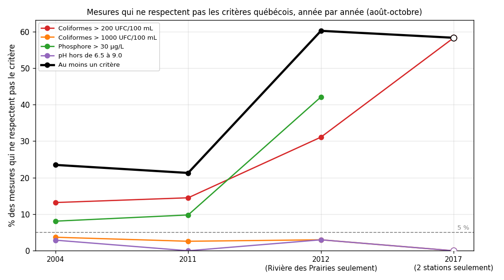

**Observation 5.2.**

- Coliformes > 200 (ligne rouge) : 13 % en 2004, 14 % en 2011, 31 % en 2012, 58 % en 2017.
- Phosphore > 30 (ligne verte) : 8 % en 2004, 10 % en 2011, 42 % en 2012, pas mesuré en 2017.
- Coliformes > 1 000 (orange) et pH (violet) restent en dessous de 4 % chaque année.
- Au moins un critère dépassé (ligne noire) : 24 %, 21 %, 60 %, 58 %.

**Analyse 5.2.**

- **Entre 2004 et 2011, les lignes sont presque plates** : il n'y a pas de changement net.
- **Le saut de 2012 n'est pas une hausse dans le temps.** 2012 ne contient que la rivière des Prairies, un autre plan d'eau, avec des taux plus élevés (voir 4.3). On compare un autre endroit, pas la même eau plus tard.
- **Le 58 % de 2017 n'est pas une dégradation.** Il vient de seulement 2 stations, dont FSL-69R, qui dépasse presque toujours le critère (100 %, 86 %, 100 % en 2004, 2011, 2017 : voir 4.5). C'est un effet du choix des stations.
- **Ce que le graphique montre de solide :** chaque année, les coliformes > 200 et le phosphore > 30 sont au-dessus de la ligne de 5 %, alors que les coliformes > 1 000 et le pH sont en dessous. Il ne montre pas si l'eau s'améliore ou se dégrade : pour ça, voir 4.4 et 4.5.

### 4.3 Comparaison des régions

Un petit graphique par critère, une barre par région et par année (barre pâle : moins de 5 stations, donc moins fiable). L'année 2017 n'y figure pas (2 stations seulement). La ligne pointillée marque 5 %.

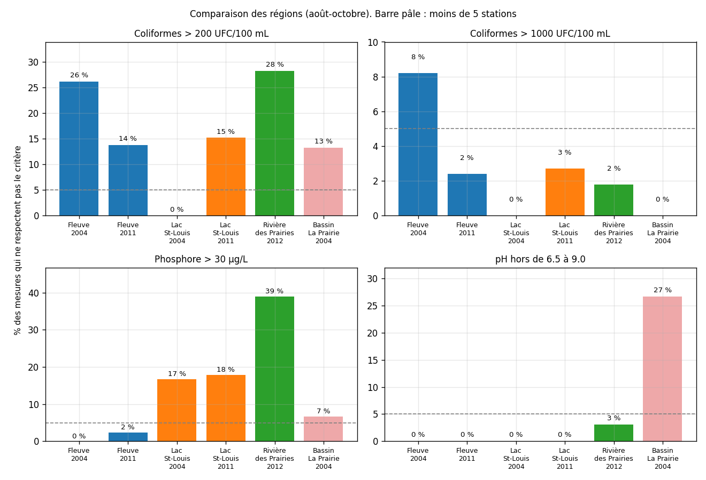

**Observation 5.3.**

- **Coliformes > 200 :** fleuve 26 % (2004) puis 14 % (2011) ; lac Saint-Louis 0 % (2004) puis 15 % (2011) ; rivière des Prairies 28 % (2012) ; bassin de La Prairie 13 % (2004).
- **Coliformes > 1 000 :** 3 % ou moins partout, sauf le fleuve en 2004 (8 %).
- **Phosphore > 30 :** lac Saint-Louis 17 % et 18 % (les deux années) ; fleuve 0 % puis 2 % ; rivière des Prairies 39 % ; bassin de La Prairie 7 %.
- **pH :** 0 % presque partout, 3 % dans la rivière des Prairies, 27 % dans le bassin de La Prairie.

Vérification statistique de deux régions la **même année** (test exact de Fisher ; seuil corrigé pour les comparaisons multiples : p < 0,00625) :

| Année | Comparaison | Critère | Résultat | p |
|---|---|---|---|---|
| 2004 | Fleuve contre lac Saint-Louis | Coliformes > 200 | 26,2 % contre 0,0 % | < 0,0001 |
| 2004 | Fleuve contre lac Saint-Louis | Phosphore > 30 | 0,0 % contre 16,7 % | 0,0006 |
| 2011 | Fleuve contre lac Saint-Louis | Coliformes > 200 | 13,8 % contre 15,2 % | 0,85 |
| 2011 | Fleuve contre lac Saint-Louis | Phosphore > 30 | 2,4 % contre 17,9 % | 0,0001 |
| 2004 | Bassin de La Prairie contre fleuve ou lac | Coliformes et phosphore | aucune différence nette | de 0,04 à 0,50 |

Verdict sur H1 (seuil de 5 %), sur les 6 groupes région-année d'au moins 15 mesures :

| Critère | H1 rejetée | H1 soutenue | Indéterminé |
|---|---|---|---|
| Coliformes > 200 | 4 | 0 | 2 |
| Coliformes > 1 000 | 0 | 1 | 5 |
| Phosphore > 30 | 3 | 0 | 3 |
| pH | 1 | 2 | 3 |

Vérification de sensibilité : dans le lac Saint-Louis, si on utilise le critère de phosphore des lacs (20 µg/L), **50,6 %** des mesures dépassent (contre 17,4 % pour 30 µg/L).

**Analyse 5.3.**

- **Aucune région n'est pire sur toute la ligne.** Le fleuve est pire pour les coliformes en 2004 (26 % contre 0 % dans le lac), mais l'écart disparaît en 2011 (14 % contre 15 %). Le lac Saint-Louis est pire pour le phosphore les deux années (17 à 18 % contre 0 à 2 % dans le fleuve, écart significatif).
- **La rivière des Prairies a les barres les plus hautes** (28 % pour les coliformes, 39 % pour le phosphore, avec 33 stations sur 34 qui ont au moins une mesure au-dessus de 30 µg/L). Mais elle n'est mesurée qu'en 2012 : on ne peut pas dire qu'elle est « pire », car son écart se mêle à l'effet de l'année et de la météo.
- **Phosphore, une réserve :** le résultat dépend du critère. Avec celui des lacs, la moitié des mesures du lac Saint-Louis dépassent.
- **pH :** le 27 % du bassin de La Prairie vient de **4 mesures prises le même jour** (26 août 2004), toutes entre 9,2 et 9,5 : un seul événement, pas un problème durable. Dans la rivière des Prairies, 7 mesures en septembre et octobre 2012 dépassent 9,0.
- **Verdict H1 :** rejetée pour les coliformes (contact direct) et le phosphore, soutenue ou presque pour les coliformes de contact indirect et le pH. Rappel : ce sont des critères, pas des normes légales.
- **Ce que le pourcentage veut dire :** c'est la proportion de mesures individuelles au-dessus du critère. Les stations ont été choisies selon les enjeux récréatifs et fauniques ou près d'émissaires d'égouts pluviaux et d'embouchures de ruisseaux : ces pourcentages décrivent ces stations, pas toute l'eau de Montréal. Les tests supposent des mesures indépendantes, ce qui n'est pas tout à fait vrai (mêmes stations, mêmes jours).

### 4.4 Évolution de chaque paramètre

**Test statistique : 2004 contre 2011, mêmes 30 stations, août-octobre.** Part de temps sec : 62 % en 2004, 21 % en 2011. Seuil corrigé pour les 21 tests : p < 0,0024. « Stations en hausse » : part des 30 stations dont la médiane est plus haute en 2011 qu'en 2004.

| Paramètre | 2004 | 2011 | Changement | p (apparié) | Stations en hausse | Fleuve (FSL) | Lac Saint-Louis (LSL) |
|---|---|---|---|---|---|---|---|
| Coliformes (UFC/100 mL) | 30,5 | 21,5 | −29,5 % | 0,0117 (non significatif) | 30 % | −47,9 % (p = 0,0007) | +12,5 % (p = 0,32) |
| Phosphore total (µg/L) | 17,5 | 16,0 | −8,6 % | 0,0008 | 13 % | −10,3 % (p = 0,0044) | −7,0 % (p = 0,063) |
| pH | 8,28 | 8,30 | +0,3 % | 0,38 | 40 % | +1,2 % | −0,6 % |
| Oxygène dissous (mg/L) | 9,54 | 9,25 | −3,1 % | 0,0058 (non significatif) | 33 % | −6,8 % (p = 0,0008) | +2,0 % |
| Conductivité (µS/cm) | 195,5 | 248,0 | +26,9 % | < 0,0001 | 97 % | +33,5 % (p = 0,0006) | +30,9 % (p = 0,011) |
| Température (°C) | 19,65 | 17,45 | −11,2 % | < 0,0001 | 0 % | −3,3 % | −21,9 % (p = 0,0006) |
| Matières en suspension (mg/L) | 2,15 | 3,40 | +58,1 % | < 0,0001 | 100 % | +33,3 % (p = 0,0001) | +73,3 % (p = 0,0006) |

L'azote ammoniacal n'est pas testé : seulement 3 stations ont des données les deux années.

**Les graphiques : toute la période (2004-2017).** Pour chaque élément, une courbe par plan d'eau : chaque point est la **médiane** de toutes les mesures de ce plan d'eau cette année-là (août-octobre). Un cercle creux veut dire moins de 5 stations ; un point seul veut dire que le plan d'eau n'a été mesuré qu'une année. Ces courbes mélangent des stations différentes selon les années : le test de 2004 contre 2011 ci-dessus (mêmes stations) est plus fiable pour juger d'un changement.

**Coliformes**

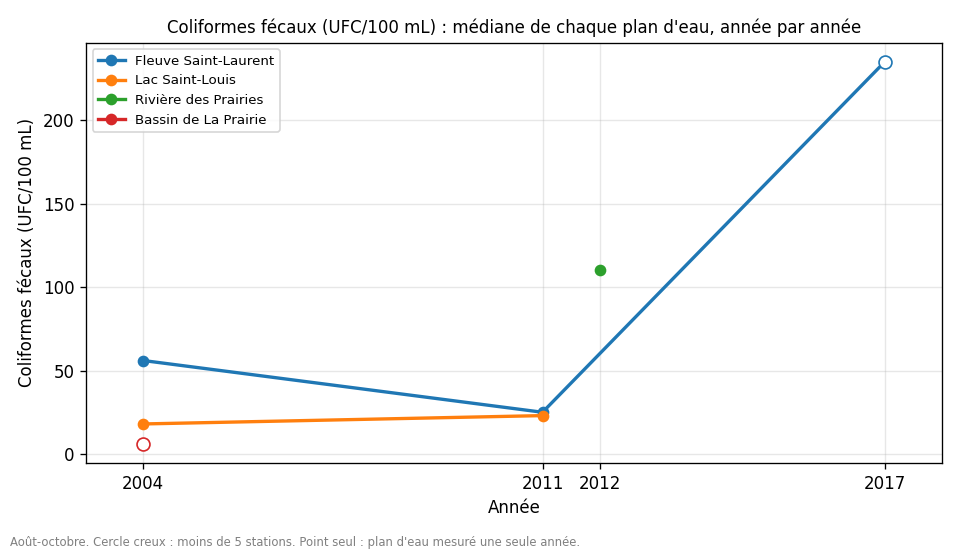

**Observation 5.4.1.** Fleuve : 56 (2004), 25 (2011), puis 235 (2017, 2 stations seulement). Lac Saint-Louis : 18 puis 23. Rivière des Prairies : 110 (2012). Bassin de La Prairie : 6 (2004, 4 stations).

**Analyse 5.4.1.** Les deux courbes ne vont pas dans le même sens entre 2004 et 2011 : le fleuve baisse, le lac monte un peu. Sur les stations communes, aucune des 15 stations du fleuve ne monte (−48 %, significatif), alors que dans le lac la médiane monte (+12 %, non significatif) ; pour l'ensemble, la baisse (−30 %) ne passe pas le seuil corrigé. La pointe de 2017 vient de 2 stations dont FSL-69R, qui est élevée depuis 2004 (voir 4.5). **Pas de tendance claire.**

**Phosphore total**

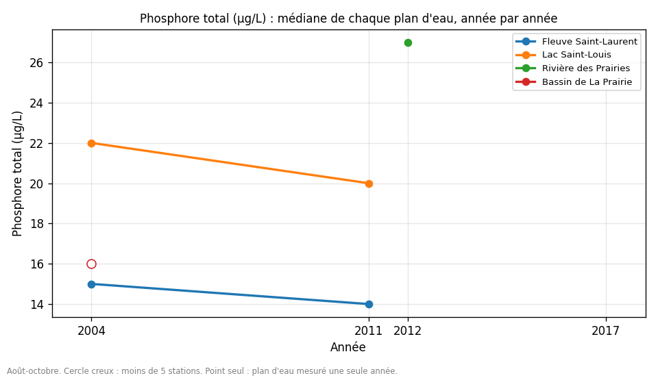

**Observation 5.4.2.** Fleuve : 15 puis 14. Lac Saint-Louis : 22 puis 20. Rivière des Prairies : 27 (2012). Bassin de La Prairie : 16. Pas de mesure en 2017.

**Analyse 5.4.2.** Les courbes sont presque plates et baissent très légèrement. Sur les stations communes, seulement 4 des 30 stations montent, et la baisse est de 8,6 % en médiane (1,5 µg/L), statistiquement distincte du hasard (p = 0,0008) mais sous le seuil de 10 % fixé pour parler de « minime ». Le pourcentage de dépassement de 30 µg/L ne change pas dans le lac (17 % puis 18 %). **Tendance existante mais minime, sans impact sur le respect du critère.**

**pH**

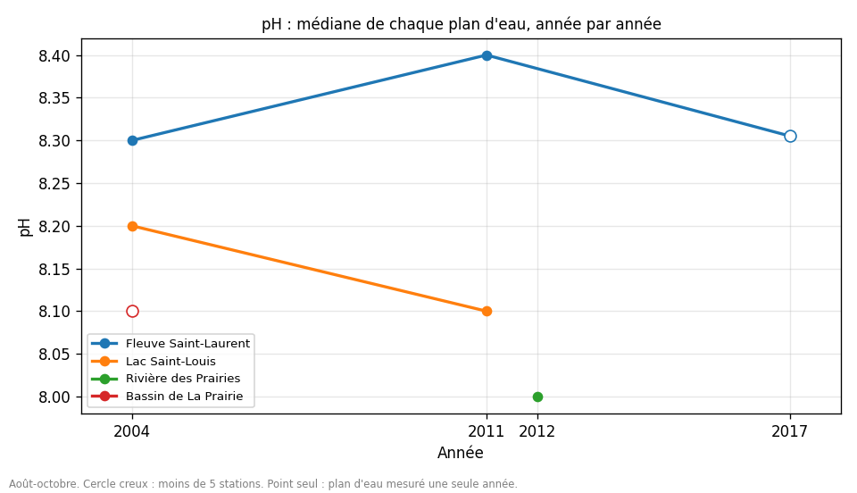

**Observation 5.4.3.** Toutes les courbes restent entre 8,0 et 8,4, y compris en 2017 (8,3).

**Analyse 5.4.3.** Les lignes sont plates. Sur les stations communes : 8,28 puis 8,30 (p = 0,38). **Aucun changement.**

**Oxygène dissous**

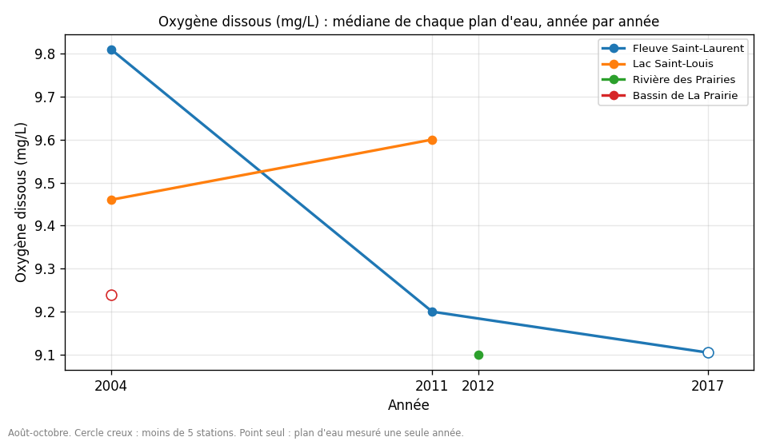

**Observation 5.4.4.** Fleuve : 9,81, 9,20, 9,10 (2004, 2011, 2017). Lac Saint-Louis : 9,46 puis 9,60. Rivière des Prairies : 9,10. Bassin de La Prairie : 9,24.

**Analyse 5.4.4.** Le fleuve baisse un peu à chaque année mesurée (−7 % de 2004 à 2017), le lac ne bouge pas. Les deux régions ne vont pas dans le même sens, et pour l'ensemble des stations communes la baisse (−3 %) n'est pas significative. Pas de critère appliqué ici. **Petite baisse locale, rien de plus.**

**Conductivité**

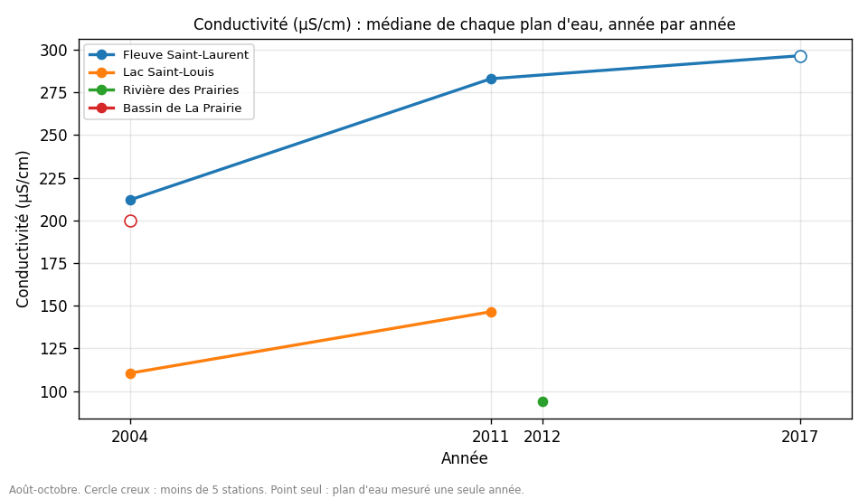

**Observation 5.4.5.** Fleuve : 212, 283, puis 296,5 (2017). Lac Saint-Louis : 110,5 puis 146,5. Rivière des Prairies : 94 (2012). Bassin de La Prairie : 200.

**Analyse 5.4.5.** Les courbes du fleuve et du lac montent en parallèle entre 2004 et 2011 (+33 % et +31 %), et **29 des 30 stations communes augmentent**, ce qui se confirme en temps sec. Mais dans le fleuve, 2011 et 2017 sont presque identiques (283 puis 296,5) : la hausse se fait entre 2004 et 2011, puis **se stabilise** (les 2 stations suivies en 4.5 le confirment). **Hausse nette entre 2004 et 2011, pas linéaire.** La cause n'est pas connue (méthode de laboratoire, sels de déglaçage, débit : rien de vérifié).

**Température**

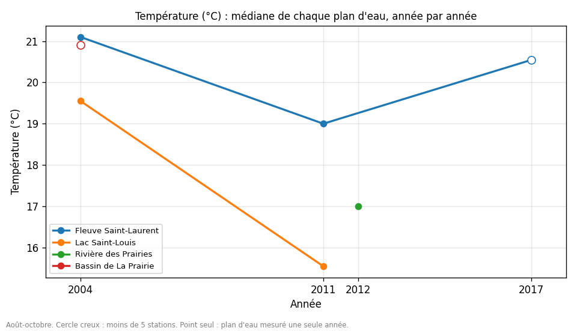

**Observation 5.4.6.** Fleuve : 21,1, 19,0, 20,5 (2017). Lac Saint-Louis : 19,6 puis 15,6. Rivière des Prairies : 17,0. Bassin de La Prairie : 20,9.

**Analyse 5.4.6.** Entre 2004 et 2011, les deux courbes baissent, et **aucune des 30 stations communes n'est plus chaude en 2011** : ce sont les jours d'échantillonnage qui diffèrent, pas l'eau. Le fleuve remonte à 20,5 °C en 2017 : pas de direction. **À ignorer.**

**Matières en suspension**

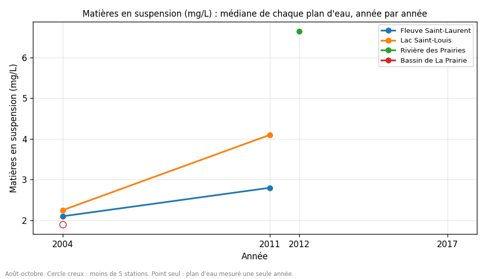

**Observation 5.4.7.** Fleuve : 2,1 puis 2,8. Lac Saint-Louis : 2,25 puis 4,1. Rivière des Prairies : 6,65 (2012). Bassin de La Prairie : 1,9. Pas de mesure en 2017.

**Analyse 5.4.7.** Les deux courbes montent entre 2004 et 2011 (+33 % et +73 %), et **les 30 stations communes sur 30 augmentent**, ce qui se confirme en temps sec : ce n'est donc pas qu'un effet de pluie. Une hausse aussi uniforme évoque une cause commune, réelle ou technique (méthode de mesure). Les valeurs restent faibles (2 à 4 mg/L). La rivière des Prairies est plus haute (6,65), mais elle n'est mesurée qu'en 2012. **Changement net, cause inconnue, à vérifier.**

**Azote ammoniacal**

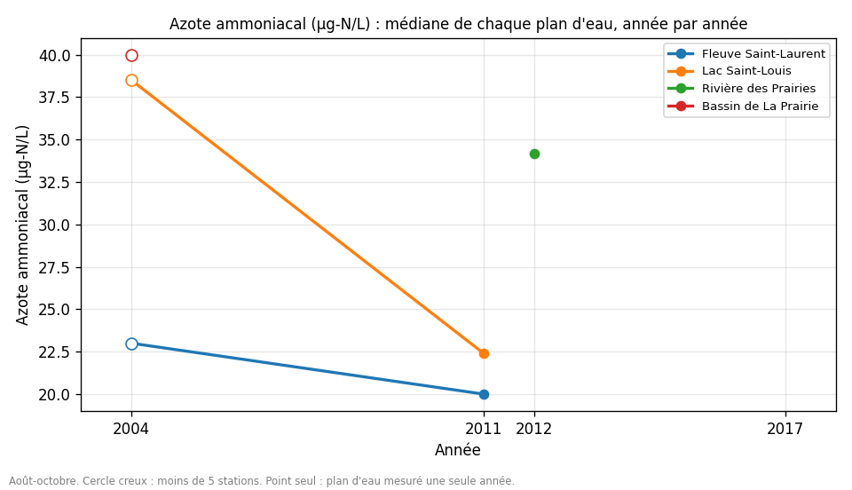

**Observation 5.4.8.** Fleuve : 23 puis 20. Lac Saint-Louis : 38,5 puis 22,4. Rivière des Prairies : 34. Bassin de La Prairie : 40. Pas de mesure en 2017.

**Analyse 5.4.8.** Les courbes baissent légèrement, mais on ne peut pas tester : seulement 3 stations ont des données les deux années, et il y a peu de mesures (28 en 2004, 78 en 2011, 84 en 2012). **Pas de conclusion.**

### 4.5 Les 2 stations suivies en 2004, 2011 et 2017

Seules FSL-67RS et FSL-69R (fleuve) ont des mesures les trois années (4, 7 et 6 mesures en août-octobre).

| Station | Année | Mesures | % coliformes > 200 | Coliformes (médiane) | pH | Oxygène (mg/L) | Conductivité | Température (°C) |
|---|---|---|---|---|---|---|---|---|
| FSL-67RS | 2004 | 4 | 0 % | 95 | 8,30 | 9,69 | 235,5 | 19,8 |
| FSL-67RS | 2011 | 7 | 29 % | 68 | 8,40 | 8,90 | 304 | 19,1 |
| FSL-67RS | 2017 | 6 | 17 % | 32,5 | 8,31 | 9,16 | 302 | 20,5 |
| FSL-69R | 2004 | 4 | 100 % | 1 000 | 8,25 | 9,43 | 218,5 | 19,6 |
| FSL-69R | 2011 | 7 | 86 % | 430 | 8,40 | 9,00 | 287 | 18,9 |
| FSL-69R | 2017 | 6 | 100 % | 325 | 8,26 | 9,00 | 285,5 | 20,6 |

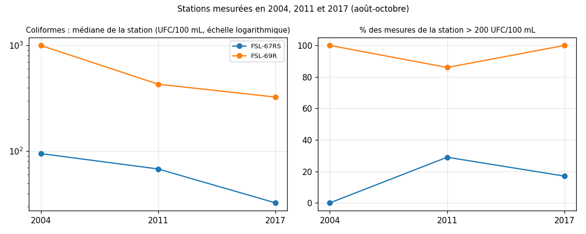

**Analyse 5.5.**

- **Coliformes :** la médiane baisse à chaque année aux deux stations (95 à 32,5 ; 1 000 à 325). Mais chaque valeur repose sur 4 à 7 mesures : c'est une indication, pas une preuve.
- **FSL-69R dépasse presque toujours le critère de 200** (100 %, 86 %, 100 %) : c'est un problème durable à cet endroit, même si le niveau baisse. C'est cette station qui explique le 58 % de 2017 dans le graphique général (4.2).
- **Conductivité :** elle saute de 235,5 à 304 puis reste à 302 (FSL-67RS) ; de 218,5 à 287 puis 285,5 (FSL-69R). Une hausse suivie d'un plateau n'est **pas linéaire** : c'est le seul vrai test de linéarité possible ici, et il contredit H2 pour ce paramètre, sur ces 2 stations seulement.
- pH, oxygène et température ne montrent pas de direction.

---

## 5. Analyse des résultats : verdict sur les hypothèses

Les analyses détaillées sont sous chaque résultat (blocs 5.1 à 5.5). Voici le verdict.

**H1 (les critères sont respectés) : en partie rejetée.**
pH : presque toujours respecté (un événement d'un seul jour au bassin de La Prairie, et 3 % de mesures hors limites dans la rivière des Prairies en 2012). Coliformes de contact indirect : presque toujours respectés. **Coliformes de contact direct : non respectés** (14 à 28 % des mesures dans 4 groupes sur 6, et FSL-69R presque toujours au-dessus). **Phosphore : non respecté** dans le lac Saint-Louis (17 à 18 %) et dans la rivière des Prairies (39 %). Le seuil de 5 % reste notre choix, et les critères ne sont pas des normes légales.

**H2 (tendance linéaire, cause qui touche toute l'île) : la partie « linéaire » est contredite là où on peut la tester, la partie « même sens » est partiellement soutenue.**
Pour la conductivité, les 2 stations suivies sur 3 années montrent un saut puis un plateau, pas une droite. Pour le sens du changement : les **MES (30 stations sur 30 en hausse) et la conductivité (29 sur 30)** augmentent dans le fleuve et le lac, ce qui va dans le sens d'une cause commune. Les **coliformes** vont en sens opposés (−48 % dans le fleuve, +12 % dans le lac), ce qui contredit H2 pour ce paramètre. La température change partout mais à cause de la météo. Avec deux années pour la plupart des stations, on ne peut pas aller plus loin.

---

## 6. Conclusion et pistes pour la suite

**Conclusion.** Dans les cours d'eau étudiés (août à octobre, 2004-2017), le pH respecte presque toujours les critères québécois, mais les **coliformes** (contact direct) et le **phosphore** les dépassent souvent. Le phosphore est le plus marqué dans la **rivière des Prairies (39 %)** et le lac Saint-Louis. Dans le temps, on ne voit pas de tendance claire pour les coliformes, le phosphore baisse très peu, et deux paramètres (**MES et conductivité**) augmentent à presque toutes les stations entre 2004 et 2011, sans qu'on puisse dire pourquoi. La station FSL-69R reste au-dessus du critère de baignade presque à chaque mesure, de 2004 à 2017.

**Idées pour pousser l'étude plus loin :**

1. **Plus d'échantillons à Montréal.** Chaque station n'a que 4 à 7 mesures par an en août-octobre, on n'a que 15 stations par région pour les comparaisons, et 2017 n'a que 2 stations. L'azote ammoniacal n'a pu être testé : 3 stations seulement avaient des données les deux années.
2. **Une période plus longue.** On a gardé août à octobre et retiré 123 mesures d'autres mois. Un suivi de mai à octobre dirait si les dépassements varient avec la saison. Idéalement, plus de 2 années comparables : avec 5 ou 6 années, on pourrait enfin tester si une tendance est linéaire.
3. **Une période qui va jusqu'à aujourd'hui (2026).** Les données utilisées s'arrêtent en 2017, et pour les cours d'eau, 2012 est la dernière année avec beaucoup de stations. Il faut voir si des mesures plus récentes existent, et si la rivière des Prairies, mesurée une seule fois (2012), a été remesurée.
4. **Un meilleur contrôle des variables.** Exemples : la **météo** (62 % de temps sec en 2004, 21 % en 2011), le **débit et le niveau du fleuve** (absents de nos données), l'**heure du prélèvement**, les **mêmes stations chaque année** (la rivière des Prairies n'est dans qu'une année), et la **méthode de laboratoire** (pour savoir si le saut de MES est réel).
5. **Étendre l'étude au-delà de l'île de Montréal.** Comparer avec d'autres rivières du Québec pour voir si la hausse de la conductivité et des MES existe aussi ailleurs, donc si la cause est régionale ou à l'échelle de la province.
6. **Explorer les causes des résultats trouvés :**
   - *Pourquoi les MES et la conductivité montent-elles à presque toutes les stations entre 2004 et 2011, puis la conductivité se stabilise-t-elle ?* (méthode de mesure, sels de déglaçage, débit, travaux dans le bassin).
   - *Pourquoi 39 % des mesures de la rivière des Prairies dépassent-elles 30 µg/L de phosphore, et 33 stations sur 34 ?* (apports agricoles ou urbains, rejets, ruissellement, comparaison avec les stations proches d'émissaires pluviaux).
   - *Pourquoi FSL-69R dépasse-t-elle presque toujours 200 UFC/100 mL alors que FSL-67RS, dans le même fleuve, reste souvent en dessous ?* (position par rapport aux égouts pluviaux, courants, météo).
7. **Compléter les critères.** Ajouter l'oxygène dissous et l'azote ammoniacal (critères qui dépendent de la température et du pH), utiliser *E. coli* en plus des coliformes fécaux, et évaluer les critères comme le fait le ministère (sur plusieurs échantillons) en plus de la proportion de mesures dépassantes.

---

## Reproduire

    pip install pandas numpy matplotlib scipy
    python analyse.py

Place les CSV dans `data/` avant de lancer le script. Les résultats (tableaux CSV et graphiques) sont écrits dans `outputs/`.
