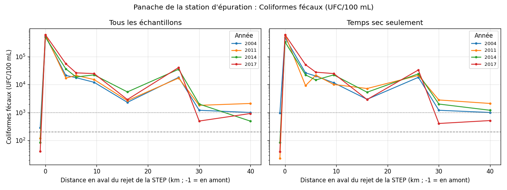
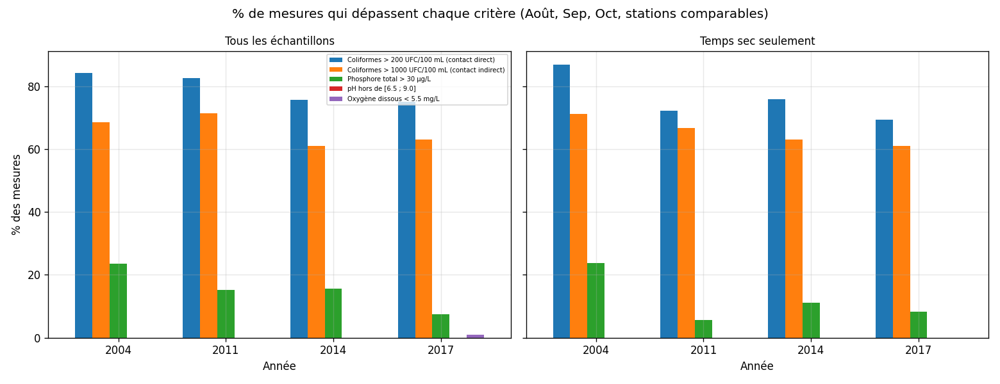

# Qualité de l'eau des cours d'eau de Montréal

<!--
COMMENT LIRE CE FICHIER
- Les blocs comme celui-ci (entre "<!--" et "-->") sont INVISIBLES sur GitHub.
  Ils sont là pour t'expliquer à quoi sert chaque section. Tu peux les garder ou les supprimer.
- Cherche "À FAIRE" : ce sont les 3 choses que toi seul peux remplir.
-->

## Question

Comment la qualité de l'eau varie-t-elle selon les stations, les saisons et les années, et à quelle fréquence dépasse-t-elle les critères de qualité du Québec ?

<!-- Une question claire en haut = le lecteur sait tout de suite de quoi parle le projet. -->

## Données

- **Source :** Ville de Montréal, programme COURDO (données ouvertes)
- **Lien :** À FAIRE (colle l'adresse de la page où tu as téléchargé les CSV, sur donnees.montreal.ca)
- **Licence :** À FAIRE (elle est indiquée sur cette même page)
- **Années :** 2004, 2011, 2012, 2014, 2017 (5 fichiers CSV)
- **Après nettoyage :** 1 370 mesures, 101 stations

<!-- Ces chiffres viennent de la sortie de ton script ("1370 mesures conservées, 101 stations").
     Si tu changes le script, relance-le et mets à jour ces chiffres. -->

## Ce que fait le script

Les 5 fichiers n'ont pas le même format. `analyse.py` règle ces problèmes avant d'analyser :

- **Formats de dates différents** d'un fichier à l'autre : essaie plusieurs formats jusqu'à ce que la date soit comprise.
- **Colonnes décalées dans le fichier 2014** : les valeurs étaient une colonne trop loin à partir du COT. Le script détecte le problème (le molybdène ne devrait jamais dépasser 1 000 µg/L) et réaligne les colonnes. Les métaux Sb à Zn de ce fichier sont ignorés, car leur alignement est incertain.
- **Limite de détection des coliformes différente selon l'année** : toutes les valeurs sont plafonnées à 600 000 UFC/100 mL pour que les années soient comparables.
- **Points de contrôle des rejets exclus** (STEP, OER) : ce sont des points au bord des rejets d'eaux usées, pas des cours d'eau. Ils sont sauvegardés à part (`outputs/donnees_exclues.csv`).
- **Deux zones analysées séparément** : la zone EMIS (panache de la station d'épuration Jean-R.-Marcotte) et les autres cours d'eau, car leur qualité n'a rien à voir.
- **Comparaison des années équitable** : seulement les mêmes stations et les mêmes mois (août à octobre), et une version « temps sec seulement » pour retirer l'effet de la pluie.

<!-- Cette section montre que tu as vu les pièges des données. C'est elle qu'un recruteur lira avec le plus d'intérêt. -->

## Résultats

### 1. En aval de la station d'épuration, la contamination fécale est très élevée, puis diminue avec la distance

La médiane de coliformes fécaux passe d'environ 225 UFC/100 mL en amont du rejet à environ 34 000 UFC/100 mL entre 0,5 et 5 km en aval. Elle redescend à environ 2 000 après 20 km.

### 2. Dépassements des critères

| Zone | Coliformes > 200 UFC/100 mL | Coliformes > 1 000 UFC/100 mL | Phosphore > 30 µg/L |
|---|---|---|---|
| Panache de la STEP (EMIS) | 76,8 % | 63,0 % | 17,7 % |
| Autres cours d'eau | 20,0 % | 2,6 % | 19,8 % |

Dans les autres cours d'eau, le pH n'est hors de l'intervalle 6,5 à 9,0 que dans 1,8 % des mesures, et l'oxygène dissous n'est jamais sous 5,5 mg/L.

Ces chiffres sont la proportion d'échantillons individuels au-dessus de la valeur du critère. Ce n'est pas une évaluation officielle de conformité.

### 3. Évolution dans le temps : aucune tendance fiable pour les coliformes

Les médianes de coliformes varient d'une année à l'autre dans le panache, mais le taux de dépassement de 200 UFC/100 mL ne monte pas (de 84 % en 2004 à 75 % en 2017). Avec seulement 4 années échantillonnées et des conditions de pluie très différentes d'une année à l'autre, une tendance ne peut pas être affirmée.

La conductivité semble augmenter dans les deux zones, mais sur 3 ou 4 années seulement. C'est une piste, pas une conclusion.

<!-- À FAIRE (pour toi) : ajoute un test statistique (ex. Mann-Whitney entre deux années)
     et remplace "ne peut pas être affirmée" par le résultat du test. Ne cite pas de p-value
     que ton script ne calcule pas : le README doit pouvoir être reproduit. -->

## Limites

- **Les stations ne sont pas choisies au hasard** : le programme échantillonne surtout autour des rejets. Les pourcentages décrivent ces stations, pas « l'eau de Montréal » en général.
- **Années inégales** : dans les cours d'eau, 2017 n'a que 12 mesures sur 2 stations et 2012 n'a aucune station en commun avec les autres années. Pour cette zone, seules 2004 et 2011 sont comparables.
- **Météo très variable** : en 2011, seulement 14 % des échantillons du panache ont été pris par temps sec, contre 76 % en 2004.
- **Correction du fichier 2014** : elle repose sur une règle de détection, pas sur une documentation officielle. Les médianes corrigées ressemblent à celles des autres années, ce qui la rend plausible.
- **Seuils** : les critères de 200 et 1 000 UFC/100 mL sont ceux du ministère de l'Environnement du Québec pour les activités récréatives. À FAIRE : cite ici le document exact où tu les as vérifiés. Les seuils d'oxygène dissous (5,5 mg/L) et de pH n'ont pas été confirmés auprès d'une source officielle.
- **Corrélation n'est pas causalité** : les graphiques montrent des associations, pas des causes.

## Reproduire

    pip install pandas matplotlib numpy
    python analyse.py

Place les fichiers CSV dans le dossier `data/` avant de lancer le script. Les résultats sont écrits dans `outputs/`.
